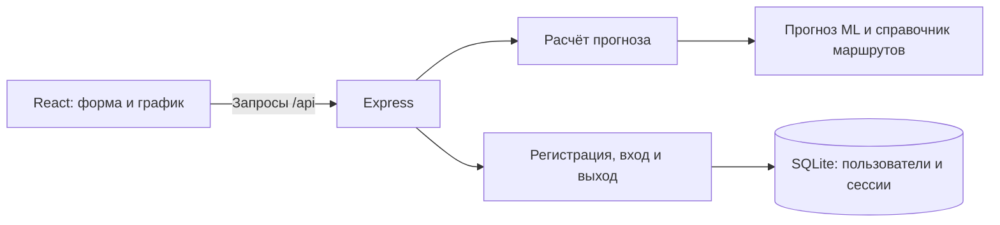

# Архитектура «Решись Авиа»

Вариант C из задания. Менеджер выбирает города, дату и цену в браузере, а сервер рассчитывает прогноз по результатам ML. Этапы ниже соответствуют плану разработки.



Выполнены этапы 1–6, включая итоговую локальную проверку. Следующий этап охватывает размещение и подготовку к сдаче.

## Границы приложения

| Часть | Что делает |
| --- | --- |
| `client/src` | React и TypeScript. Выбор городов, даты и цены, показ прогноза, график Chart.js и формы входа. |
| `server/src` | Express и TypeScript. Проверка запросов, выбор рейса и расчёт. Регистрация, вход и выход находятся в authRouter.ts. |
| `data` | Наш CSV с прогнозом и исходный `routes.csv`. Сервер читает их при старте. |
| `storage` | Каталог SQLite по умолчанию. На хостинге нужен постоянный диск для файла базы. |

В разработке Vite перенаправляет `/api` на Express. После сборки Express отдаёт и страницу, и API с одного адреса. Так интерфейс в обоих режимах обращается к относительным путям `/api/...`.

## Интерфейс

`App.tsx` соединяет `ForecastForm`, `ForecastResult` и `DemandChart`. Форма управляет полями
и передаёт результат в `App.tsx`. Запросы и типы ответов описаны в `api/forecast.ts`,
общие форматы даты и чисел — в `utils/format.ts`. Логотип хранится в `assets`.
Сервер подключает `forecastRouter.ts` под `/api`. Расчёт находится в `forecast.ts`.

Слева форма выбора рейса, справа результат с крупным прогнозом продаж.
На телефоне результат расположен под формой. Тёмно-зелёная панель и светлая
форма визуально разделяют ввод и итог. Заголовок набран Georgia, а поля
и подписи используют системный шрифт. Страница загружает список рейсов
с сервера, сохраняет дату при смене маршрута, если она доступна, и подставляет
его базовую цену. При изменении полей прежний результат сбрасывается.

## Прогноз

1. Интерфейс передаёт код маршрута, дату вылета и цену в рублях.
2. Сервер находит строку прогноза по паре `route` и `date`, а по `route` берёт базовую цену и чувствительность из справочника.
3. Сервер пересчитывает медиану и девять квантилей. Ограничение вместимости применяется к прогнозу продаж.

```text
спрос = 0.5_base_demand − price_sensitivity × (цена − base_price)
продажи = min(seats, max(0, спрос))
```

Для каждого квантиля подставляется его `X_base_demand`. `seats` означает вместимость рейса. API возвращает значения формулы без округления и может вернуть отрицательный расчётный спрос при высокой цене. Тогда продажи равны нулю. На графике значение при 50% совпадает с медианным спросом, а линия вместимости показывает, где продажи упираются в число мест.

`DemandChart` строит точечный график на Chart.js. Ось X показывает расчётный спрос, ось Y показывает вероятность того, что спрос не превысит это значение. Девять точек соответствуют квантилям 10–90%. Медиана выделена цветом и размером, вместимость отмечена вертикальной пунктирной линией. Под графиком раскрывается таблица со значениями.

## API

| Запрос | Назначение | Этап |
| --- | --- | --- |
| `GET /api/health` | Проверить, что сервер отвечает. | 1 |
| `GET /api/forecast?route=MOW-AER&date=2026-06-01&price=10000` | Получить `route`, `routeName`, `date`, `price`, `seats`, `demand`, `sales` и `quantiles`. | 2 |
| `GET /api/routes` | Вернуть коды маршрутов, названия городов, доступные даты и базовые цены для формы. | 3 |
| `POST /api/auth/register` | Создать пользователя. | 5 |
| `POST /api/auth/login` | Проверить пароль и создать сессию. | 5 |
| `GET /api/auth/me` | Узнать, кто сейчас вошёл. | 5 |
| `POST /api/auth/logout` | Завершить сессию. | 5 |

Неверный ввод в прогнозе возвращает `400` и `{ "error": "…" }`. Если маршрут и дата корректно записаны, но такого рейса нет в данных, сервер отвечает `404`. Форму и доступные даты строим по данным сервера, чтобы список в браузере совпадал с CSV.

## Вход и хранение

`authStore.ts` открывает SQLite и создаёт таблицы `users` и `sessions`.
`users` содержит идентификатор, уникальный email и хеш пароля с индивидуальной
солью. `passwords.ts` использует scrypt и сравнение хешей за постоянное время.
Старый хеш заменяется на новый после успешного входа.
В `sessions` хранятся идентификатор пользователя, SHA-256 от случайного
токена и время окончания сессии.

`AccountMenu` показывает состояние сессии и обрабатывает выход.
`AuthDialog` содержит формы регистрации и входа. После регистрации
он предлагает войти с новым паролем. После входа браузер получает cookie с `HttpOnly` и `SameSite=Lax` на 7 дней.
В режиме `NODE_ENV=production` также устанавливается `Secure`.
Выход удаляет запись сессии и cookie. `limitAuthAttempts.ts` ограничивает
вход и регистрацию 20 запросами в минуту на IP, который видит Express.
За доверенным прокси этот IP определяется с учётом `TRUST_PROXY_HOPS`.
Расчёт доступен сразу, а после входа в шапке появляется email.
При недоступности /me шапка показывает сообщение и кнопку «Повторить».
Гостевое состояние устанавливается после успешного ответа без пользователя.

## Проверка и размещение

- Этап 2: проверить расчёт при базовой цене, изменение цены, ограничение вместимостью, нулевые продажи и ошибки запроса.
- Этап 3: проверить выбор рейса, расчёт и восстановление после ошибки из браузера.
- Этап 4: проверить девять квантилей, медиану, линию вместимости и масштабирование графика.
- Этап 5: проверить регистрацию, повторный вход, сохранение сессии и выход.
- Этап 6: проверены чистая установка, сборка и сценарий от регистрации до расчёта и выхода. 620 комбинаций рейса и цены сверены с CSV.
- Этап 7: разместить приложение с HTTPS и постоянным диском SQLite, проверить ссылку и сохранение сессии после перезапуска.

При сдаче приложить исходники и ссылку на работающий сайт. Расчёт сверять с формулами на страницах 12–14 исходного PDF.
